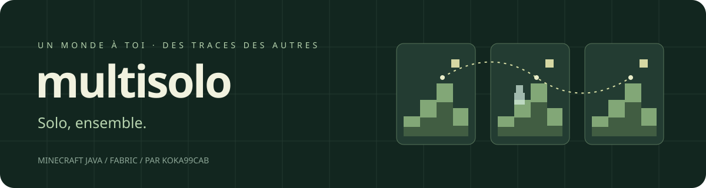

<p align="center">
  
</p>

<p align="center">
  <strong>Ton monde. Tes découvertes. La présence des autres.</strong><br>
  Un projet de mod Fabric par <strong>koka99cab</strong>.
</p>

<p align="center">
  <a href="docs/DESIGN.md">Le concept</a> ·
  <a href="docs/ROADMAP.md">La suite</a> ·
  <a href="docs/DEVELOPMENT.md">Développer</a> ·
  <a href="docs/MAINTENANCE.md">Maintenir</a>
</p>

## Une aventure solo qui laisse passer les autres

Multisolo veut relier des parties solo **indépendantes**, jouées sur une même
seed. Des messages laissés au même endroit, des silhouettes furtives, et un
appel à l'aide pour accueillir temporairement un autre joueur : l'inspiration
vient du multijoueur asynchrone d'Elden Ring.

Chaque joueur garde sa sauvegarde et sa progression. Le **spawn vanilla est
conservé**. Les invités ont un inventaire verrouillé : ils ne doivent ni prendre
le butin, ni modifier les constructions. Les permissions sociales se règlent
dans le menu Multisolo ; les règles d'une expérience restent communes.

## État réel du projet

**v0.1 — Connected Solitude**, en développement (`0.1.0-dev.5`).
La seed de cette première expérience est **`0`**. Chaque joueur crée une
sauvegarde indépendante, en survie normale verrouillée, avec le spawn vanilla.

| Disponible dans le dépôt | À construire |
| --- | --- |
| Création d'une expérience seed 0 depuis le menu | Validation complète du JAR distribué |
| Menu FR/EN, consentement et fonctionnement hors ligne | Hébergement HTTPS du relais (VPS OVH envisagé) |
| Identité réseau cryptographique persistante | Essais du relais en conditions publiques |
| Panneaux vanilla partagés, vocabulaire fermé et votes | Silhouettes et entraide, après la v0.1 |
| CI, veille des versions et guide pour les bots | Portages vérifiés sur les autres versions Java 26.x |

Le [contrat de la v0.1](docs/releases/0.1-connected-solitude.md) décrit les limites
et les critères de diffusion. Le relais est testé localement et **n'est pas
déployé publiquement**. Cette version de développement n'est pas une release validée.

La cible de compilation est **Minecraft Java `26.4-snapshot-3`**, avec
**Java 25** et **Fabric Loader 0.19.5**. Au 12 octobre 2026, 26.4 est encore
en développement. Aucune compatibilité en jeu n'est déclarée avant les essais
du [protocole de validation](docs/TESTING.md).

L'objectif final est de supporter **Minecraft Java depuis 26.1**, version par
version. Le manifeste cible aujourd'hui uniquement la snapshot courante ; les
messages restent isolés par version pour respecter les différences de génération.

## Une installation simple

L'objectif est **un seul mod à ajouter : `multisolo-….jar`**, dans un profil
Minecraft utilisant Fabric Loader. Fabric API, Mod Menu ou une bibliothèque de
configuration ne sont pas à installer séparément : les quatre modules Fabric API
utilisés sont embarqués avec leurs licences.

Les codes `core` et `network` sont inclus dans le même JAR. Fabric Loader reste
le prérequis de lancement. Pour les essais de cette alpha, utiliser un profil
avec Multisolo seul ; les autres mods ne sont pas encore validés.

Dans l'accueil : **Multisolo → Créer Connected Solitude — seed 0**.
Pour le social : renseigner le relais et activer
le partage après lecture du consentement. Dans une partie Multisolo, **poser un
panneau vanilla**, puis choisir « Panneau fantôme : oui » dans son menu habituel.
Composer ses **quatre lignes prédéfinies** avec les flèches, puis « Partager ce
panneau ». Échap annule le brouillon ; un panneau ordinaire garde son texte libre local.

Le bloc posé reste un panneau Minecraft normal. Chez un autre joueur, Multisolo
place une **copie temporaire du panneau vanilla**, au même endroit, avec son type
et son orientation. Il faut de l'air libre et un support valide : aucune construction
n'est remplacée. Le panneau apparaît ou disparaît seulement hors du champ de la
caméra pendant une seconde, à au moins huit blocs. Ces copies sont en lecture seule
et ne donnent aucun loot. Accroupi + clic droit, mains vides, ouvre le menu vanilla
avec les votes pour / contre. Le menu « Panneaux proches » conserve aussi les
messages sans emplacement disponible. Recliquer un vote l'annule ; un auteur peut
supprimer son partage sans casser son panneau d'origine.

La présence dure **7 jours + 1 jour par upvote − 1 jour par downvote**, avec un
minimum de **1 jour** et un maximum de **30 jours depuis la publication**.
Les votes positifs donnent donc plus de persistance aux indications utiles.
Une expiration retire la copie lorsqu'elle est hors champ, sans effacer l'archive
sur le relais. Un message expiré ne peut plus recevoir de votes. Aucun site
d'archives n'est encore fourni.

Le partage porte uniquement des identifiants de phrases prédéfinies ; le relais
refuse le texte libre. Aucun message social n'est envoyé au chat et aucun
signalement Mojang ou Multisolo n'est ajouté. Le texte garde la couleur vanilla
du panneau ; aucun choix de couleur Multisolo pour le moment. Les lectures proches
se rafraîchissent toutes les dix secondes quand
le social est activé dans une expérience compatible.

## Commencer à développer

Installer un **JDK 25**, puis :

```powershell
# Windows
.\gradlew.bat build
.\gradlew.bat :fabric:runClient
```

```sh
# Linux / macOS
./gradlew build
./gradlew :fabric:runClient
```

Le JAR du mod se trouve dans `fabric/build/libs/`. Le JAR `-sources` et celui
de `core` ne sont pas des mods supplémentaires à installer.

Le relais local démarre avec `./gradlew :relay:run` (`.\gradlew.bat` sous Windows),
à l'adresse `http://127.0.0.1:8787`. Le [guide relais](docs/RELAY.md) détaille
la persistance, le conteneur Docker et la préparation d'un futur VPS.

## Se repérer

```text
core/              Règles métier Java, sans dépendance à Minecraft ou Fabric
network/           Identité, protocole et client HTTP indépendants du jeu
relay/             Service autonome de messages persistants
fabric/            Adaptateur du jeu et unique JAR distribué
docs/              Conception, architecture, maintenance et décisions
schemas/           Contrats JSON pour les expériences et la compatibilité
scripts/           Veille de versions et vérification du dépôt
.github/           CI, veille planifiée, modèles d'issues et de PR
AGENTS.md          Instructions de travail pour les assistants et bots
compatibility.json État lisible par une machine, sans promesses de compatibilité
compose.yaml       Préparation du relais pour Docker / VPS
```

Pour un humain, commencer par le [concept](docs/DESIGN.md), puis
l'[architecture](docs/ARCHITECTURE.md). Pour un agent, lire [AGENTS.md](AGENTS.md).
Les choix structurants sont conservés dans les [décisions](docs/decisions/0001-foundation.md).

## Construire quelque chose qui dure

Une première expérience vanilla, puis des expériences distinctes selon la
génération du monde. Une nouvelle seed ou difficulté donne une nouvelle
révision ; elle ne réécrit jamais une partie existante. La même seed seule ne
suffit pas à garantir des mondes compatibles entre versions ou mods.

La veille GitHub est préparée pour détecter de nouvelles versions et ouvrir
une tâche de portage. Un bot pourra ensuite préparer une PR selon le
[guide de maintenance](docs/MAINTENANCE.md), avec compilation, tests et essais
en jeu avant publication. La veille ne réalise pas encore le portage toute seule.

L'organisation s'inspire de [Simple Voice Chat](https://github.com/henkelmax/simple-voice-chat),
[Sodium](https://github.com/CaffeineMC/sodium) et
[Lithium](https://github.com/CaffeineMC/lithium) ; le build suit le
[template Fabric](https://github.com/FabricMC/fabric-example-mod).

Contributions : [CONTRIBUTING.md](CONTRIBUTING.md). Licence du code original :
[MIT](LICENSE). Multisolo est un projet indépendant, sans affiliation à Mojang ou Microsoft.
