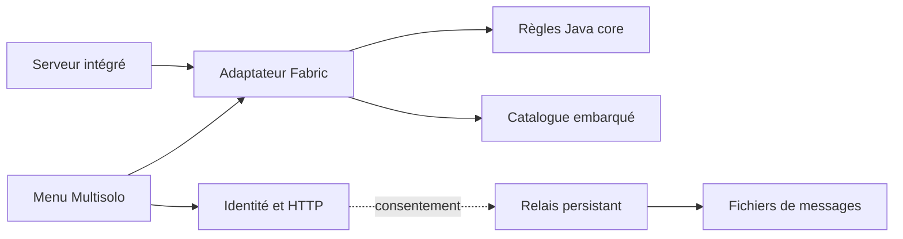

# Architecture

## Quatre modules, un mod

`core` contient les règles testables sans le jeu : `Experience`,
`CompatibilityKey`, `SocialConsent` et `GuestPolicy`. Il ne dépend d'aucun loader.
Le module rend les portages plus petits ; il ne garantit pas la compatibilité
avec une nouvelle version de Minecraft.

`network` contient protocole, signature Ed25519, identité persistante et client
HTTP. Il dépend de `core` et de Gson, sans Minecraft. `relay` est une application
Java autonome : vérification des requêtes, stockage borné et interrogation spatiale.
Le relais ne dépend pas de Fabric et n'est jamais inclus dans le JAR joueur.

`fabric/src/main` contient catalogue, métadonnées du monde et verrouillage de
difficulté. `src/client` contient les écrans et le worker réseau. Les événements
Fabric gèrent les écrans et le cycle de vie. Un mixin limite les setters de
difficulté dans les expériences marquées ; voir la [décision 0002](decisions/0002-connected-solitude.md).

La tâche `:fabric:jar` inclut les classes de `core` et `network` : un seul fichier est
distribué. Les sources sont également produites pour faciliter le diagnostic.
Les quatre modules Fabric API requis sont des JARs imbriqués. Leur présence et
leurs licences sont vérifiées dans l'artefact produit.

## Sources de vérité

| Information | Emplacement |
| --- | --- |
| Versions de build | `gradle.properties` |
| Statut réel des fonctionnalités et validation | `compatibility.json` |
| Règles d'une expérience | `fabric/src/main/resources/data/multisolo/experiences/*.json` |
| Format des fichiers | `schemas/` |
| Règles de contribution des agents | `AGENTS.md` |

La seed est stockée comme chaîne décimale pour éviter une perte de précision
dans les outils JSON/JavaScript. Le chargeur la convertit en `long` signé.
Le catalogue est une ressource embarquée du mod, pas une commande distante.

## Limites d'autorité à construire

Le client exprime un consentement ; le serveur vérifie l'action. Aucun paquet
du client ne peut être considéré comme preuve d'une permission ou d'un rôle.
La future session d'entraide doit lier identité, hôte, expérience et expiration.
`GuestPolicy` est actuellement un contrat testé, **pas un filtre déjà branché
sur les paquets Minecraft**.

Les sauvegardes ordinaires sont exclues de l'application des règles Multisolo.
Le bouton de création utilise `WorldOpenFlows.createFreshLevel`, une seed longue
zéro explicite et le preset normal vanilla. Il écrit `multisolo-experience.json`
dans un répertoire neuf. Au lancement, la version exacte, l'expérience et la
seed sauvegardée sont contrôlées avant d'activer les règles. Aucune donnée de
spawn n'est remplacée. Une divergence exige une migration explicite.

Le partage est réservé aux expériences solo marquées, au profil de mods vérifié
et aux datapacks vanilla/Fabric. Les publications et votes sont lancés à la demande du joueur ; les lectures
sont rafraîchies toutes les dix secondes après consentement,
hors thread du jeu. Désactiver ou changer de monde annule le travail en cours et
efface les messages affichés. Le [protocole](PROTOCOL.md) décrit la frontière
d'autorité du relais.

## Panneaux vanilla

`MessagePhrase` impose exactement quatre identifiants de catalogue ; `PhantomSign`
ajoute la face. Le champ RGB historique reste dans le format v2 pour relire les
publications existantes, mais le rendu conserve la teinture et la luminosité
vanilla du panneau local. Le relais valide le même modèle. Les votes sont
persistés séparément de la publication immuable, un vote par identité.

`SignEditorSession` ajoute les contrôles à `AbstractSignEditScreen`, sans écran de
composition séparé. Les mixins client bloquent la saisie libre en mode fantôme,
changent uniquement l'état de rendu du texte et empêchent l'envoi d'un paquet
vanilla depuis une consultation distante. Le mixin commun sauvegarde les
métadonnées de l'auteur sur le vrai `SignBlockEntity`. Les raisons de chaque
mixin sont dans le code et la [décision 0003](decisions/0003-vanilla-phantom-signs.md).
