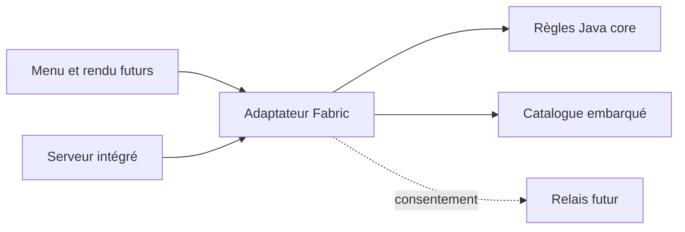

# Architecture

## Deux modules, un mod

`core` contient les règles testables sans le jeu : `Experience`,
`CompatibilityKey`, `SocialConsent` et `GuestPolicy`. Il ne dépend d'aucun loader.
Le module rend les portages plus petits ; il ne garantit pas la compatibilité
avec une nouvelle version de Minecraft.

`fabric` contient le point d'entrée et la lecture du catalogue. Les futures
API du serveur, les mixins nécessaires et l'adaptation réseau appartiennent à
`src/main`. Les écrans et le rendu iront dans `src/client` pour éviter de charger
des classes client sur un serveur dédié. Aucun mixin n'est nécessaire au socle.

La tâche `:fabric:jar` inclut les classes de `core` : un seul fichier est
distribué. Les sources sont également produites pour faciliter le diagnostic.
Il n'y a pas de framework multiloader, de backend vide ou de bibliothèque de
configuration ajoutée avant un besoin réel.

## Sources de vérité

| Information | Emplacement |
| --- | --- |
| Versions de build | `gradle.properties` |
| Statut réel des fonctionnalités et validation | `compatibility.json` |
| Règles d'une expérience | `fabric/src/main/resources/data/multisolo/experiences/*.json` |
| Format des fichiers | `schemas/` |
| Règles de contribution des agents | `AGENTS.md` |

La seed est stockée comme chaîne décimale pour éviter une perte de précision
dans les outils JSON/JavaScript. Le chargeur la convertit en `long` signé.
Le catalogue est une ressource embarquée du mod, pas une commande distante.

## Limites d'autorité à construire

Le client exprime un consentement ; le serveur vérifie l'action. Aucun paquet
du client ne peut être considéré comme preuve d'une permission ou d'un rôle.
La future session d'entraide doit lier identité, hôte, expérience et expiration.
`GuestPolicy` est actuellement un contrat testé, **pas un filtre déjà branché
sur les paquets Minecraft**.

Les sauvegardes ordinaires sont exclues de l'application des règles Multisolo.
Créer une expérience signifie créer un nouveau monde marqué, avec sa définition
persistée. Lors d'une mise à jour, vérifier cette définition ; ne pas l'écraser
avec le nouveau catalogue. Ne pas enregistrer de compatibilité en jeu sur la
seule base d'une compilation réussie.
